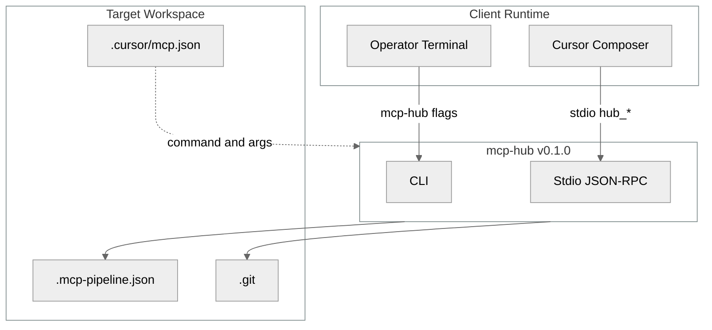
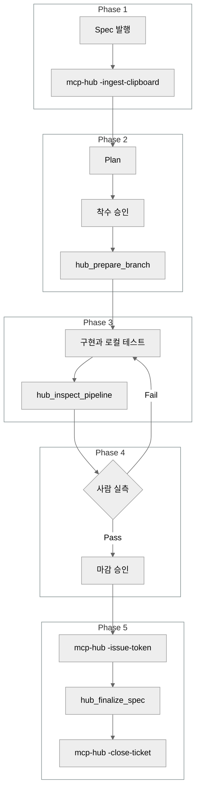

# mcp-pipeline-hub

`mcp-hub` v0.1.0은 하나의 바이너리로 Operator CLI와 Cursor stdio MCP 서버를 제공한다. MCP 서버 키와 `serverInfo.name`은 `agentic-mcp-hub`다.

- [1. Overview](#1-overview)
- [2. Features & Philosophy](#2-features--philosophy)
- [3. Installation](#3-installation)
- [4. Quick Start (`-init`)](#4-quick-start--init)
- [5. Cursor MCP Configuration](#5-cursor-mcp-configuration)
- [6. CLI Reference](#6-cli-reference)
- [7. MCP Tools Reference](#7-mcp-tools-reference)

## 1. Overview

워크스페이스 루트에서 `mcp-hub`를 실행한다. 모드 플래그가 없고 `-root`가 있으면 JSON-RPC stdio 서버로 동작한다. `-init`, `-ingest-clipboard`, `-issue-token`, `-close-ticket`, `-version`은 사람 Operator용 CLI다.



기본 설정 파일은 `<root>/.mcp-pipeline.json`이다. `-init`이 만드는 서버 등록은 `.cursor/mcp.json`이다.

## 2. Features & Philosophy

| 용어 | 의미 |
| --- | --- |
| 항상 성립 조건 (Invariant) | 어떤 시점에도 참이어야 하는 조건이다. 티켓 접두사 대소문자는 입력 그대로다. `-init`은 `-force` 없이 기존 스캐폴드 파일을 덮어쓰지 않는다. |
| 지연 아카이빙 (Delayed Archiving) | 사람 실측 전에는 Spec을 `_archive/`로 옮기지 않는다. 활성 Spec은 `<vault>/03_Spec (구현명세서)/` 루트에 둔다. |
| 수술적 Staging (Surgical Staging) | `git add .`를 쓰지 않는다. 기능 브랜치 커밋에서 `<vault>/`, `TODO.md`, `.cursor/`, `repomix-output.xml`을 뺀다. |
| 일회용 챌린지 토큰 (Challenge Token) | 사람이 `mcp-hub -issue-token <티켓ID>`로 발급한다. 표시 문자열 접두사는 `tok_`다. 디스크에는 SHA-256 해시만 `.git/mcp-finalize-tokens/<티켓ID>.json`에 둔다. TTL은 300초다. `hub_finalize_spec`이 성공하면 그 파일을 지운다. |

착수 승인 전에는 구현하지 않는다. 승인 직후 `hub_prepare_branch`가 `feature/<티켓ID>`를 만들거나 그 브랜치로 전환한다. `sync_main` 기본값은 true다.



## 3. Installation

릴리스 베이스 URL:

```text
https://github.com/eric2935/mcp-pipeline-hub/releases/download/v0.1.0/
```

`v0.1.0` 태그가 `origin`에 없으면 이 URL은 404다. 파일명 규칙은 [`.github/workflows/release.yml`](.github/workflows/release.yml)과 같다. 빌드는 `CGO_ENABLED=0`이고, 아카이브 루트에는 바이너리 하나만 들어 있다. 업로드 자산은 아카이브 5개와 `checksums.txt`다.

| GOOS | GOARCH | 아카이브 | 안의 바이너리 |
| --- | --- | --- | --- |
| darwin | amd64 | `mcp-hub_v0.1.0_darwin_amd64.tar.gz` | `mcp-hub` |
| darwin | arm64 | `mcp-hub_v0.1.0_darwin_arm64.tar.gz` | `mcp-hub` |
| linux | amd64 | `mcp-hub_v0.1.0_linux_amd64.tar.gz` | `mcp-hub` |
| linux | arm64 | `mcp-hub_v0.1.0_linux_arm64.tar.gz` | `mcp-hub` |
| windows | amd64 | `mcp-hub_v0.1.0_windows_amd64.zip` | `mcp-hub.exe` |

`checksums.txt`의 각 줄은 `sha256sum` 형식(`해시` 두 칸 `파일명`)이다. 아카이브 5개와 `checksums.txt`가 같은 디렉터리에 있을 때의 정본 확인:

```bash
sha256sum -c checksums.txt
```

아카이브 하나만 받았을 때:

```bash
grep mcp-hub_v0.1.0_darwin_arm64.tar.gz checksums.txt | sha256sum -c -
```

| 환경 | 단일 아카이브 확인 |
| --- | --- |
| Linux | `grep <파일명> checksums.txt \| sha256sum -c -` |
| macOS | `grep <파일명> checksums.txt \| shasum -a 256 -c -` |
| Windows | Git Bash에서 Linux와 같은 `sha256sum -c -` |

Unix 아카이브는 `tar -xzf <파일명>`으로 푼다. Windows zip은 `tar -xf <파일명>` 또는 `unzip`으로 푼다. 푼 바이너리 이름이 PATH에서 `mcp-hub`여야 `.cursor/mcp.json`의 `command`와 맞는다.

### Go toolchain

모듈 경로는 `mcp-pipeline-hub`다. 첫 경로 요소에 점이 없어서 `go install mcp-pipeline-hub/cmd/mcp-hub@v0.1.0`과 `@latest`는 모듈 프록시로 설치되지 않는다.

체크아웃에서 설치한다. `go.mod`의 Go 버전은 1.26.5다.

```bash
git clone https://github.com/eric2935/mcp-pipeline-hub.git
cd mcp-pipeline-hub
go install ./cmd/mcp-hub
```

바이너리를 현재 디렉터리에 두려면:

```bash
go build -o mcp-hub ./cmd/mcp-hub
```

`go install`은 `$(go env GOPATH)/bin`에 둔다. 그 디렉터리가 PATH에 있어야 한다.

| 빌드 | `mcp-hub -version` stdout |
| --- | --- |
| `-ldflags` 없는 로컬 빌드 | `mcp-hub 0.1.0` |
| 태그 `v0.1.0` 릴리스 빌드 | `mcp-hub v0.1.0` |

릴리스 빌드는 `-X mcp-pipeline-hub/internal/protocol.ServerVersion=<태그>`로 버전 문자열을 넣는다. `-version`은 그 문자열만 stdout에 쓰고 끝낸다. stderr는 비운다. 종료 코드는 0이다.

## 4. Quick Start (`-init`)

```bash
mcp-hub -init -project "your-project" -prefix "HUB"
```

| 플래그 | 생략 시 |
| --- | --- |
| `-prefix` | `PROJ` |
| `-project` | 대상 디렉터리 이름 |
| `-vault` | `obsidian-docs/v2` |
| `-force` | 끄짐. 이미 있는 스캐폴드 파일은 유지 |
| `-root` | `.` |

stdout은 JSON이다. 키는 `created`, `updated`, `skipped`, `overwritten`다. stderr 한 줄 접두사는 `[CREATE]`, `[SKIP]`, `[OVERWRITE]`, `[UPDATE]`다.

같은 명령을 `-force` 없이 다시 실행하면 기존 파일은 `[SKIP]`이고 내용은 유지된다. `-force`는 스캐폴드 파일을 덮어쓴다. `.gitignore`는 `-force`여도 통째로 바꾸지 않고, 없는 줄만 추가한다.

생성되는 경로:

| 경로 | 역할 |
| --- | --- |
| `.mcp-pipeline.json` | 티켓 접두사, 볼트, Spec 경로, dirty 목록 |
| `TODO.md` | 작업 보드 |
| `.cursor/mcp.json` | Cursor MCP 서버 등록 |
| `.cursorrules` | 착수, 브랜치, Staging 규칙 |
| `.cursorignore` | Cursor 색인 제외 |
| `repomix.config.json` | `hub_pack_context` 팩 설정 |
| `.repomixignore` | 팩 제외 |
| `<vault>/01_SOP (표준운영절차)/표준-업무-매뉴얼.md` | Operator 절차 |
| `<vault>/01_SOP (표준운영절차)/SOP - 지식창고 분류 체계 (Taxonomy).md` | 분류 |
| `<vault>/06_Cheatsheet/GLS - Project Glossary.md` | 용어 |
| `<vault>/03_Spec (구현명세서)/` | 활성 Spec |
| `<vault>/03_Spec (구현명세서)/_archive/` | 마감된 Spec |

`.gitignore`에 없으면 다음 줄을 추가한다. `<vault>/`, `repomix-output.xml`, `bin/`, `.cursor/`.

## 5. Cursor MCP Configuration

`command`는 PATH의 `mcp-hub`다. `-root`는 워크스페이스 절대경로다. 서버 모드에서는 `-root`를 비우면 종료 코드 2와 `mcp-hub: -root is required`다.

```json
{
  "mcpServers": {
    "agentic-mcp-hub": {
      "command": "mcp-hub",
      "args": ["-root", "/absolute/path/to/workspace"]
    }
  }
}
```

설정 파일 경로를 바꾸려면 `args`에 `-config`와 경로를 붙인다. 기본값은 `<root>/.mcp-pipeline.json`이다.

프로토콜은 한 줄에 JSON-RPC 하나다. 지원 버전은 `2024-11-05`와 `2025-03-26`이다. 그 외 클라이언트 버전은 `2024-11-05`로 응답한다.

## 6. CLI Reference

모드 플래그는 한 번에 하나만 쓴다. `-init`, `-ingest-clipboard`, `-close-ticket`, `-issue-token`, `-version` 중 둘 이상이면 stderr는 `mcp-hub: -init, -ingest-clipboard, -close-ticket, -issue-token, and -version are mutually exclusive`이고 종료 코드는 2다. stdout은 비운다.

| 플래그 | 인자 | 동작 |
| --- | --- | --- |
| `-init` | 없음 | 파이프라인 파일을 만든다. 상세는 4절. |
| `-ingest-clipboard` | 없음 | OS 클립보드의 Spec을 쓰고, 티켓 줄이 없으면 `TODO.md`의 `## In Progress` 바로 아래에 한 줄 넣는다. stdout은 `spec_file_path`, `todo_line`, `todo_updated`. |
| `-issue-token` | 티켓 ID | 일회용 `tok_` 토큰을 stdout 한 줄로 찍고 클립보드에 복사한다. 복사가 실패해도 stdout 토큰은 유효하다. stderr는 `WARN: clipboard copy failed`만 추가한다. |
| `-close-ticket` | 없음 | 기능 브랜치에서, 이미 `_archive/`에 있는 Spec의 `commit_type`, `commit_scope`, `commit_summary`로 대상 파일을 반영한다. `close_exclude_paths`는 제외한다. 원격 `main`에 머지된 뒤 `TODO.md`를 Done으로 옮긴다. Spec이 `_archive/`에 없으면 실패한다. |
| `-version` | 없음 | stdout `mcp-hub <ServerVersion>` 한 줄 후 종료한다. `pipeline.Open`과 MCP stdio는 호출하지 않는다. |
| `-debug` | 없음 | 오류 시 stderr에 `[DEBUG]`를 붙인다. 기본 stderr는 `CODE: Detail` 한 줄이다. Detail이 비어 있으면 `CODE`만 출력한다. |

`-debug` 없이 `MCP_DEBUG=1` 또는 `MCP_DEBUG=true`여도 `[DEBUG]`를 켠다. 비교는 대소문자를 무시한다. 그 외 값은 끄진다. stdout에는 오류와 디버그를 쓰지 않는다.

| 플래그 | 인자 | 제약 |
| --- | --- | --- |
| `-root` | 경로 | 모드 플래그의 기본 워크스페이스는 `.`다. MCP stdio는 명시적 `-root`가 필수다. |
| `-config` | 경로 | 파이프라인 설정. 기본 `<root>/.mcp-pipeline.json`. |
| `-token` | 티켓 ID | `-issue-token`과 같은 값의 별칭이다. 둘 다 있고 값이 다르면 종료 코드 2다. |
| `-prefix` | 접두사 | `-init` 전용. 없으면 종료 코드 2. |
| `-vault` | 디렉터리 | `-init` 전용. 없으면 종료 코드 2. |
| `-project` | 이름 | `-init` 전용. 없으면 종료 코드 2. |
| `-force` | 없음 | `-init` 전용. 없으면 종료 코드 2. |

| 종료 코드 | 의미 |
| --- | --- |
| 0 | 성공 |
| 1 | 실행 오류. stderr에 `CODE: Detail` 또는 일반 메시지 |
| 2 | 플래그 조합 오류 |

## 7. MCP Tools Reference

도구는 다섯 개다. `hub_verify_pipeline`과 `hub_archive_spec`은 없다. 레거시 이름 `iems_*`는 같은 다섯 도구로 연결된다. 다섯 도구는 `git commit`과 `git push`를 실행하지 않는다.

| 도구 | Phase | 필수 인자 | 동작 | 하지 않는 일 |
| --- | --- | --- | --- | --- |
| `hub_pack_context` | 1 | 없음 | `npx repomix --no-gitignore`. 제한 30초. `ssot_manifests`의 각 문자열이 산출물에 있어야 한다. 목록이 비어 있으면 그 검사는 통과한다. | Git 쓰기 |
| `hub_ingest_spec` | 1 | 없음 | `ticket_id`, `scope`, `title`, `spec_markdown`이 모두 비어 있으면 클립보드를 읽는다. 선택 인자는 `todo_line`이다. Spec을 쓰고, 없는 티켓만 `TODO.md`에 한 줄 넣는다. | 이미 있는 티켓 줄 중복 삽입 |
| `hub_prepare_branch` | 2 | `ticket_id` | `feature/<티켓ID>` 또는 slug가 있으면 `feature/<티켓ID>-<slug>`. 선택 인자는 `slug`, `sync_main`(기본 true), `allow_dirty`(기본 false)다. | `commit`, `push`, 브랜치 삭제. 블랙리스트 밖 추적 변경이면 `ERR_DIRTY_WORKTREE` |
| `hub_inspect_pipeline` | 3 | 없음 | 현재 브랜치, 활성 Spec, stageable 파일, 블랙리스트 dirty 파일을 보고한다. | 빌드, 테스트, Spec 이동 |
| `hub_finalize_spec` | 5 | `ticket_id`, `finalize_token`, `commit_type`, `commit_scope`, `commit_summary` | 토큰을 검사하고 `status: completed`와 커밋 필드 세 개를 기록한 뒤 `_archive/`로 옮긴다. `terminal_commands`는 `mcp-hub -close-ticket`이다. | Phase 3과 4에서 호출. 토큰 없이 호출. `git add`, `commit`, `push` |

`hub_prepare_branch`의 기본 dirty 통과 경로는 `TODO.md`, `repomix-output.xml`, `<vault>/`, `.cursor/`다. `sync_main`이 true이고 `TODO.md`가 바뀌어 있으면 전환 전에 `.git/mcp-todo.bak`로 보관한 뒤 브랜치에서 복원한다. 전역 `git stash`는 쓰지 않는다.

`hub_finalize_spec`은 브랜치가 `feature/<티켓ID>`일 때만 성공한다. 토큰이 없거나, 300초가 지났거나, 해시가 다르면 실패한다. 성공한 토큰은 다시 쓰지 못한다.
